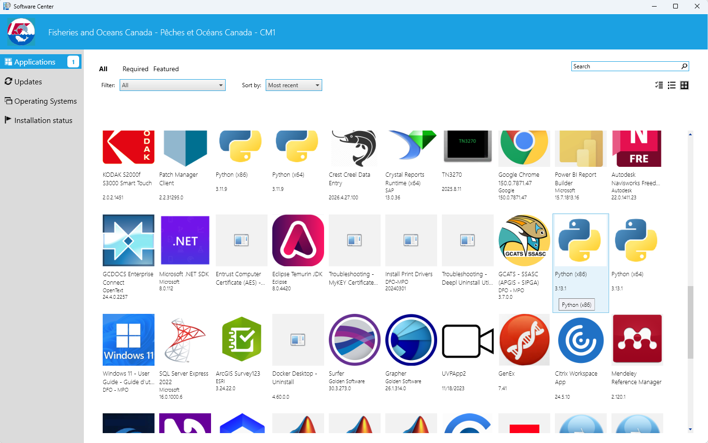

## DFO Overspend Program  
Started: July 13th, 2026  
Last Updated: July 21st, 2026  

### About  
This program aims to help automate the Department of Fisheries and Oceans Canada financial system, by flagging overbudget cardholders. The program requires an SAP file and a Blanket Authority Excel sheet to run, and will flag cardholders with the Government of Canada who have gone above their authorized budget. After flagging, the program should offer an emailed report to authorized supervisors.

### Installation
This program is run on Python 3.13.1, which can be downloaded from the Software Center application on DFO computers. Ensure you download the Python version that's right for your CPU's architexture (x86 or x64).

| Software Center - Main Page | Software Center - Python Installed | 
|------------|------------|
|  |  |

After downloading Python 3.13.1, click on the the `overspendprogram.py` file in the GitHub repo, and press `Shift + S` to download. Alternatively, download the `package.zip` file the same way, and right click and extract all in your file explorer. 
 

### Running  

You can run the program by double clicking the `overspendprogram.py` source file. The program will open in the terminal, and prompt you to paste the file paths of the SAP and Blanket Authority Excel sheets, before running and outputting a new Excel document with information of the flagged cardholders and their GL account numbers. 

### Contact
Email: Kai.Pearson@dfo-mpo.gc.ca  
GitHub: kaipearson-dfo  
