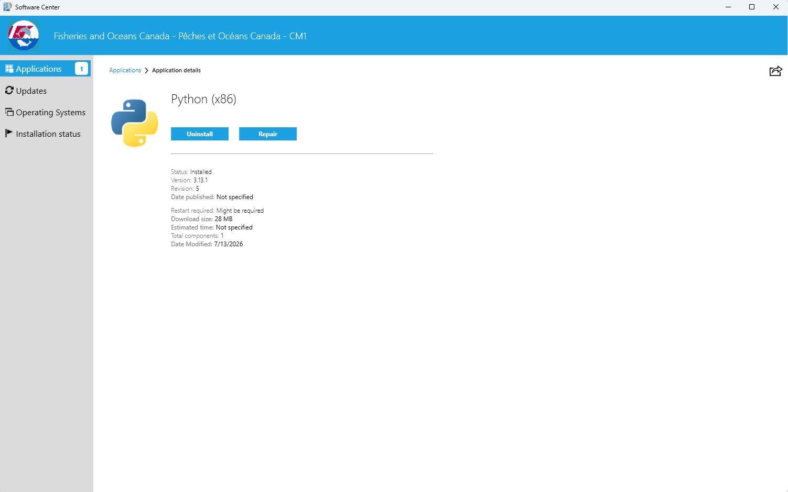

## DFO Overspend Program  
Started: July 13th, 2026  
Last Updated: July 21st, 2026  

### About  
This program aims to help automate the Department of Fisheries and Oceans Canada financial system, by flagging overbudget cardholders. The program requires at least 1 SAP extract file and a Blanket Authority tracking sheet to run. It's job is to flag cardholders with the Government of Canada who have gone above their authorized budget, alongside flagging other issues or concerns from the SAP extract. 

### Installation
This program is run on Python 3.13.1, which can be downloaded from the Software Center application on DFO computers. Ensure you download the Python version that's right for your CPU's architexture (x86 or x86-64).

| Software Center - Main Page | Software Center - Python Installed | 
|------------|------------|
|  |  |

After downloading Python 3.13.1, download and extract the `dfo-overspend-project` file in the GitHub repo, and press `Shift + S` to download. 

### Running  

You can run the program by double clicking the `overspendprogram.py` source file. The program will open in the terminal, and prompt you to paste the file paths of the SAP and Blanket Authority Excel sheets, before running and outputting a new Excel document with information of the flagged cardholders and their GL account numbers. 

### Contact
Email: Kai.Pearson@dfo-mpo.gc.ca  
GitHub: kaipearson-dfo  
